# Database Architecture & Entity Relationship (ER) Diagram

This document details the database schema, entity models, relationships, and PostgreSQL constraints used in **MathPath AI**, managed via **Prisma ORM** and hosted on **Neon Serverless PostgreSQL**.

---

## 📊 Entity Relationship Diagram (Mermaid)

```mermaid
erDiagram
    USER ||--o{ NOTE : "authors"
    USER ||--o{ ROADMAP : "creates"
    USER ||--o{ TOPIC_PROGRESS : "tracks"
    USER ||--o{ ASSESSMENT_RESULT : "completes"
    USER ||--o{ POST : "publishes"
    USER ||--o{ COMMENT : "writes"
    USER ||--o{ VOTE : "casts"

    SUBJECT ||--|{ TOPIC : "contains"

    TOPIC ||--o{ ROADMAP_NODE : "mapped_in"
    TOPIC ||--o{ TOPIC_PROGRESS : "logged_for"
    TOPIC ||--o{ QUESTION : "tagged_in"

    ROADMAP ||--|{ ROADMAP_NODE : "composed_of"

    ASSESSMENT ||--|{ QUESTION : "includes"
    ASSESSMENT ||--o{ ASSESSMENT_RESULT : "evaluates"

    POST ||--o{ COMMENT : "receives"
    POST ||--o{ VOTE : "aggregates"

    USER {
        string id PK "UUID"
        string email UK "Unique email address"
        string passwordHash "Bcrypt hashed password"
        string name "User full name"
        string avatarUrl "Profile image URL"
        enum role "STUDENT | EDUCATOR | ADMIN"
        datetime createdAt "Timestamp"
        datetime updatedAt "Timestamp"
    }

    NOTE {
        string id PK "UUID"
        string userId FK "Foreign Key -> User.id"
        string title "Note headline"
        string content "Text content of note"
        string tag "Subject tag e.g. Linear Algebra"
        datetime createdAt "Timestamp"
        datetime updatedAt "Timestamp"
    }

    SUBJECT {
        string id PK "UUID"
        string title UK "Subject name"
        string slug UK "URL-friendly slug"
        string description "Subject summary"
        string icon "Icon identifier"
        datetime createdAt "Timestamp"
        datetime updatedAt "Timestamp"
    }

    TOPIC {
        string id PK "UUID"
        string subjectId FK "Foreign Key -> Subject.id"
        string title "Topic title"
        string slug UK "Topic slug"
        string description "Topic overview"
        enum difficulty "BEGINNER | INTERMEDIATE | ADVANCED"
        int orderIndex "Sequence order"
        datetime createdAt "Timestamp"
        datetime updatedAt "Timestamp"
    }

    ROADMAP {
        string id PK "UUID"
        string userId FK "Foreign Key -> User.id"
        string title "Roadmap name"
        string description "Roadmap objective"
        boolean isPublic "Visibility toggle"
        datetime createdAt "Timestamp"
        datetime updatedAt "Timestamp"
    }

    ROADMAP_NODE {
        string id PK "UUID"
        string roadmapId FK "Foreign Key -> Roadmap.id"
        string topicId FK "Foreign Key -> Topic.id"
        enum status "LOCKED | IN_PROGRESS | COMPLETED"
        float positionX "Graph X coordinates"
        float positionY "Graph Y coordinates"
        datetime createdAt "Timestamp"
        datetime updatedAt "Timestamp"
    }

    TOPIC_PROGRESS {
        string id PK "UUID"
        string userId FK "Foreign Key -> User.id"
        string topicId FK "Foreign Key -> Topic.id"
        enum status "LOCKED | IN_PROGRESS | COMPLETED"
        datetime completedAt "Nullable completion date"
        datetime updatedAt "Timestamp"
    }

    ASSESSMENT {
        string id PK "UUID"
        string title "Assessment title"
        string description "Description"
        datetime createdAt "Timestamp"
        datetime updatedAt "Timestamp"
    }

    QUESTION {
        string id PK "UUID"
        string assessmentId FK "Foreign Key -> Assessment.id"
        string topicId FK "Nullable Foreign Key -> Topic.id"
        string prompt "Question text"
        json options "Array of 4 options"
        string correctAnswer "Answer text"
        string explanation "Detailed explanation"
        enum difficulty "BEGINNER | INTERMEDIATE | ADVANCED"
    }

    ASSESSMENT_RESULT {
        string id PK "UUID"
        string userId FK "Foreign Key -> User.id"
        string assessmentId FK "Foreign Key -> Assessment.id"
        float score "Percentage or raw score"
        json details "Detailed breakdown"
        datetime createdAt "Timestamp"
    }

    POST {
        string id PK "UUID"
        string userId FK "Foreign Key -> User.id"
        string title "Forum post title"
        string content "Markdown discussion"
        string_array tags "Topic tags"
        datetime createdAt "Timestamp"
        datetime updatedAt "Timestamp"
    }

    COMMENT {
        string id PK "UUID"
        string postId FK "Foreign Key -> Post.id"
        string userId FK "Foreign Key -> User.id"
        string content "Reply text"
        datetime createdAt "Timestamp"
        datetime updatedAt "Timestamp"
    }

    VOTE {
        string id PK "UUID"
        string postId FK "Foreign Key -> Post.id"
        string userId FK "Foreign Key -> User.id"
        int value "+1 or -1"
    }
```

---

## 🔑 Key Schema Constraints & Indexes

1. **Unique Constraints**:
   - `User.email` — Guarantees unique student accounts.
   - `Subject.slug` & `Subject.title` — Disallows duplicate subject records.
   - `Topic.slug` — Unique topic URL identifiers.
   - `@@unique([roadmapId, topicId])` — Prevents identical topics from being added twice into a roadmap.
   - `@@unique([userId, topicId])` — Ensures one progress record per user per topic.
   - `@@unique([postId, userId])` — Prevents duplicate votes from a single user on a community post.

2. **Cascade Deletions (`onDelete: Cascade`)**:
   - Deleting a `User` cascades to delete their associated `Roadmap`, `Note`, `TopicProgress`, `Post`, `Comment`, and `Vote` records to prevent orphaned entries.
   - Deleting a `Subject` automatically cascades and removes its child `Topic` records.
